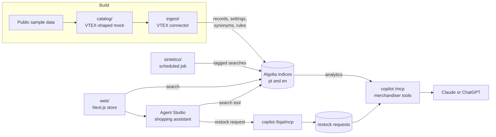

# Agentic retail search in Brazilian Portuguese

[](https://github.com/luisfelipecr/algolia-demo/actions/workflows/ci.yml)

A demo built on Algolia for a fashion and footwear store in Brazil: a storefront with Portuguese search, a
shopping assistant, a VTEX to Algolia connector and an MCP server that turns search analytics into
merchandising decisions.

- Store in Portuguese: https://algolia-demo-ten.vercel.app
- Store in English: https://algolia-demo-ten.vercel.app/en
- Merchandiser copilot (MCP, read only): `https://copiloto-loja-demo.fly.dev/mcp`

## Why this demo

Large Brazilian retailers mostly run on VTEX, which has its own search and no official Algolia connector. The
questions a Brazilian merchant asks are concrete: does search understand "tênis 39", plurals and gender
agreement in Portuguese, and can it tell me which sizes I am losing sales on? This repository answers them with
standard Algolia features on the Free plan, and keeps every setting as code so the whole thing can be rebuilt.

## How it fits together

1. **Catalog** (`catalog/`): builds a Brazilian Portuguese catalog in the shape of a VTEX store from Algolia's
   public fashion dataset: products and size SKUs, prices in reais, Brazilian sizes, a versioned translation.
   It is written as a mock of the VTEX Legacy Search API. See `catalog/README.md`.
2. **VTEX connector** (`ingest/`): reads the catalog page by page with the VTEX pagination rules, groups SKUs by
   color and indexes one record per style and color. It handles both the canonical VTEX model (one product with
   color and size SKUs) and the older one product per color. Settings, synonyms and rules live in
   `ingest/config/` and the connector only applies what changed. Today it reads the mock; a client for a live
   VTEX store would plug in behind the same interface.
3. **Storefront** (`web/`): Next.js with React InstantSearch and a restricted search key in the browser.
4. **Shopping assistant** (`agent/`): an Algolia Agent Studio agent behind the chat button, with versioned
   instructions.
5. **Merchandiser copilot** (`copiloto/`): an MCP server that reads Algolia analytics and the indexed catalog.
6. **Evaluation** (`evals/`): golden sets that check the live indices.
7. **Synthetic traffic** (`sintetico/`): declared searches and clicks, so the analytics has volume.



## Search in Portuguese

- The Portuguese index uses the language code `pt`, not `pt-br`: Algolia supports plurals for `pt` and not for
  `pt-br`.
- Synonyms cover vocabulary ("tênis" and "sneaker") and gender agreement ("bolsa vermelha" finds products whose
  color is "vermelho"), which plurals do not cover.
- Sizes in stock are searchable, so "tênis 39" returns only sneakers with size 39 in stock, and words such as
  "tamanho" are optional.
- Rules turn "promoção", "liquidação" and "oferta" into a filter on products on sale.
- Filters by size in stock, color, brand, category and price, sorting by price and a product page.

The English store is the same store with its own index: English plurals and stop words, its own synonyms (US and
UK spelling, trainers, tee) and rules, and the same record IDs, so the language switch keeps you on the same
product. Prices stay in reais and sizes stay Brazilian.

## Shopping assistant

The agent answers only from what the search tool returns in the same turn: name, brand, price, sizes in stock
and sales. It does not state stock, sizes or discounts it did not see, it treats "tênis" and "sapatênis" as
different products, and it sends questions about orders and deliveries to customer service. It answers in the
language of the question and searches the matching index. When the size a shopper asks for is sold out, it
offers similar products and, if the shopper says yes, records a "let me know when it is back" request through
a second MCP endpoint, `https://copiloto-loja-demo.fly.dev/loja/mcp`, which exposes only that tool, so the
assistant never sees the merchandiser tools. The demo keeps no contact details: the request becomes a restocking
signal for the merchandiser. The instructions are in `agent/instrucoes.md`; the dashboard holds a copy.

## Merchandiser copilot

An MCP server with tools a merchandiser would ask for, in Portuguese:

- searches with no results, each with a diagnosis: a size filter that hit a stockout, a combination the
  catalog does not have, a likely typo, a product the store does not carry, or a search that already works today;
- lost demand by size: how often each size was searched, by filter or typed in the query, against how many
  products have that size in stock;
- a restocking suggestion per category: the sold out sizes shoppers asked for, lost sales first (searches that
  hit a stockout and "let me know" requests from the assistant), and which styles to restock in each size. It
  gives no quantities, because those come from sales, which the demo does not have;
- top searches and how many products each one finds;
- data coverage: until when the analytics goes and what the Free plan keeps;
- a channel to report a wrong number, which records the complaint with the last calls as context.

Every answer says the period, how fresh the data is and where it comes from, because the Free plan keeps only 7
days of analytics and "no data" is not "no demand". A name that does not match (category, size, store) fails with
the list of valid values instead of returning zero, and every line says how much of it comes from the synthetic
traffic. Run locally, the copilot can also create a synonym, only
after the exact draft is shown and confirmed with a code tied to that draft.

To try it, add the URL above as a connector:

- **Claude** (claude.ai, web or desktop): Settings, Connectors, Add custom connector, paste the URL.
- **ChatGPT**: Settings, Apps, Advanced settings, turn on Developer mode; then Create app with the URL and no
  authentication. After a server update, use Refresh on the app.
- **Claude Code**: `claude mcp add --transport http copiloto https://copiloto-loja-demo.fly.dev/mcp`

Then ask, in Portuguese or English (answers come in Brazilian Portuguese, the language of the store team): "Quais
buscas não tiveram resultado nos últimos 7 dias?", "How is demand by size for women's sneakers?", "Where should I
restock first in women's sneakers?". After an update of the server, reconnect the connector so the client reads
the new tool descriptions.

## Evaluation

The golden sets have 34 Portuguese and 14 English queries with semantic expectations (accents, plurals, typos,
price limits, sizes, colors, gender), checked against properties of the hits or counts from the local catalog,
never against the ranking being tested. They caught two bad synonyms before release. Reports are in
`evals/resultados/`. The copilot was checked by asking the same question on Claude and ChatGPT over four rounds:
each wrong conclusion was traced to a tool that said too little and fixed there (see
[`docs/DECISIONS.md`](docs/DECISIONS.md)).

## Data

- The catalog is derived from public sample data: Algolia's `ecommerce-federated` dataset and the commercetools
  Sunrise sample data, both pinned to a commit with a checksum, and translated to Portuguese. Photos are
  hotlinked from the commercetools sample data.
- Stock quantities are synthetic. No real customer or brand data is used.
- Synthetic traffic: a store built for a demo gets few visits, so a scheduled job can send searches and clicks
  written by hand from the catalog (`sintetico/cenario.json`). Every one of them carries the analytics tag
  `sintetico` and a `sintetico-NN` user token, and the copilot reports how many searches in each period are
  synthetic.

## Run it locally

Python 3.12 with `uv`, and Node 22 or later for the store. Copy `.env.example` to `.env` and `web/.env.example`
to `web/.env.local` with your Algolia keys. Keys, the Agent Studio agent and the scheduled job are created in the
dashboard: see [`docs/DASHBOARD-SETUP.md`](docs/DASHBOARD-SETUP.md).

```bash
uv run python -m catalog.build                 # source data to the VTEX mock in data/vtex/ and data/vtex/en/
uv run python -m ingest.indexar                # dry run; add --aplicar to write to Algolia
uv run python -m ingest.indexar --idioma en    # the English index
uv run python -m evals.rodar                   # golden set (one multi-query, 34 searches; --idioma en: 14)
uv run python -m copiloto                      # MCP server over stdio (--http PORT for HTTP on localhost)
npm --prefix web ci && npm --prefix web run dev
uv run pytest && uv run ruff check .           # tests and lint
```

## Documentation

- [`docs/DECISIONS.md`](docs/DECISIONS.md): design decisions, discarded paths and known limitations.
- [`docs/DASHBOARD-SETUP.md`](docs/DASHBOARD-SETUP.md): API keys, the Agent Studio agent and the scheduled job.
- [`catalog/README.md`](catalog/README.md) and [`web/README.md`](web/README.md): the catalog build and the store.
- Project notes in Portuguese: [`docs/CONTRATO-INDICE.md`](docs/CONTRATO-INDICE.md) (index contract),
  [`docs/fontes/algolia.md`](docs/fontes/algolia.md) (verified Algolia facts, including where the product behaved
  differently from the docs), [`docs/fontes/vtex.md`](docs/fontes/vtex.md) (VTEX APIs),
  [`docs/LICOES.md`](docs/LICOES.md) (lessons from MCP servers in production) and
  [`AGENTS.md`](AGENTS.md) (the engineering manual used with coding agents).

## Limits of the Free plan found along the way

- 3 rules per index in practice, although the pricing page says 10.
- 7 days of analytics retention, so the copilot reports the effective period of every answer.
- Records up to 10 KB, so related products from the source dataset stay out of the record.
- 10K searches per month: the store key is restricted by referer and by rate per IP, and the evaluation runs as
  one multi-query with analytics turned off.
- Analytics API details: the filters that emptied a search only come back when the search is given, and the
  search count leaves out the current day when the period ends today.

## License

Code under the MIT license (`LICENSE`). The catalog data comes from the public sample datasets cited above, under their own terms.
